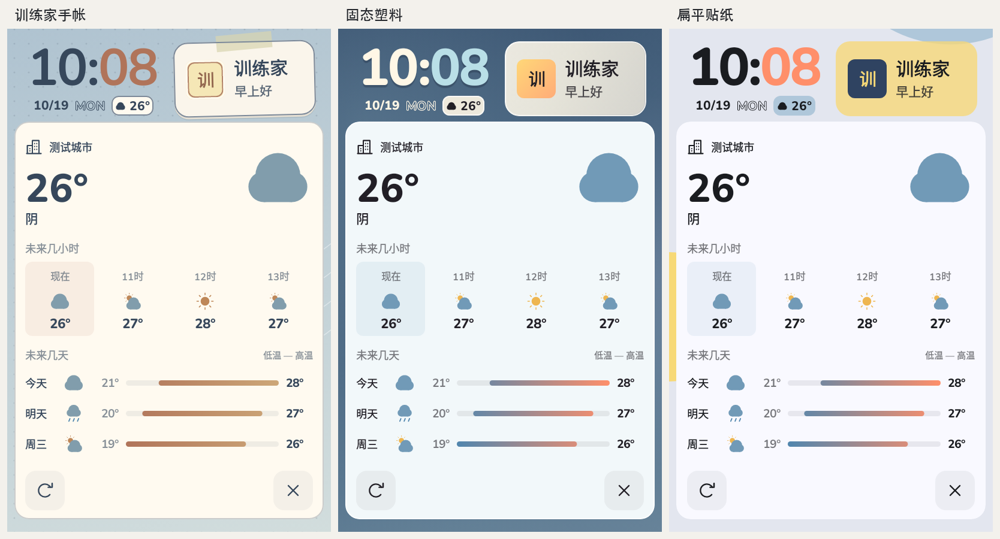

# TitoDex Launcher

面向 Android 游戏掌机的轻量桌面，使用 **Kotlin + Jetpack Compose**。保留「训练家手帐」「固态塑料」「扁平贴纸」三种视觉风格，支持触屏、方向键和手柄。

当前预览版：**0.3.2-adaptive.8 / versionCode 14**。代码已从 TitoDex App 独立，原生工程直接位于仓库根目录，不需要 Flutter 或 TitoDex App 才能运行。

[下载预发布版本](https://github.com/Tito-XD/tito-dex-launcher/releases) · [开发上下文](docs/AI_CONTEXT.md) · [交接](HANDOFF.md) · [拆分记录](docs/MIGRATION.md)

## 桌面与操作

- 保留 Android 状态栏、导航栏和系统安全留边；方屏、横屏、竖屏各自保存桌面布局。
- 时间单独一行，日期、镂空英文星期和天气同排；另保留 1×2 竖向时钟。
- 天气卡片显示当前、逐小时和每日预报。顶部楼房图标切换城市，左下刷新，右下叉号只收起卡片。
- 主应用入口默认延续 TitoDex，也可以替换为任意已安装应用或隐藏。
- 个人名片、常玩应用、系统小组件和壁纸可在整理桌面中调整，支持撤销。
- 上滑或点击进入应用库；长按图标查看选项或拖到常玩区；返回键按层级退出。
- 入场、壁纸切换、模块归位和手柄焦点过渡支持关闭动效；拖动直接跟手。



图片为原生组件测试渲染，使用演示天气和模拟图标，不是真机截图。布局细节见 [ADAPTIVE_LAYOUT.md](ADAPTIVE_LAYOUT.md)。

## 构建与检查

需要 JDK 17、Android SDK 36 和 Build Tools 36.0.0。设置 `JAVA_HOME`、`ANDROID_HOME`，或用未跟踪的 `local.properties` 指定 Android SDK。

```sh
./gradlew --no-daemon --max-workers=2 :app:testDebugUnitTest :app:assembleDebug :app:assembleRelease
```

输出为 `app/build/outputs/apk/debug/app-debug.apk` 和 `app/build/outputs/apk/release/app-release.apk`。当前预览沿用开发签名；自行或 CI 构建的证书未必与已安装版本相同，请勿为安装而卸载或清除数据。正式分发前需另行规划签名迁移。

CI 运行 JVM / 原生组件检查和 Debug 构建，不自动发布 APK，也不代表真机验收。

## 安装与设备验证

包名保持 `com.tito.titodex.launcher`，版本号、偏好 schema 和小组件 host ID 连续。升级须使用相同证书覆盖安装。默认桌面由用户在系统选择器中确认。

真机验证必须先备份，再保留数据安装，最后恢复并核对偏好和壁纸：

```sh
python3 tool/test_device.py <serial> \
  --apk app/build/outputs/apk/release/app-release.apk \
  --debug-apk app/build/outputs/apk/debug/app-debug.apk
```

不要卸载、清除数据或直接运行会自动卸载的设备测试。脚本生成的私有备份留在忽略的 `build/validation/`。本版尚未在 RG 上验证；过往设备记录见 [VALIDATION.md](VALIDATION.md)。发布流程见 [RELEASING.md](RELEASING.md)。

## 数据与来源

- 设置、城市、照片和布局只存本机，不读取 TitoDex App 私有数据，不申请定位。
- 天气和城市搜索由 [Open-Meteo](https://open-meteo.com/) 提供；使用所选城市坐标，请遵循其 [CC BY 4.0 署名与服务条款](https://open-meteo.com/en/terms)。
- Nunito 按 SIL OFL 1.1 使用，许可全文在 `app/src/main/res/raw/nunito_ofl.txt`，应用内也可查看。
- 设计参考、动效来源与当前三主题约定见 [DESIGN_SYSTEM](docs/DESIGN_SYSTEM.md) 和 [MOTION](MOTION.md)。未复制参考项目代码或素材。
- 非官方个人项目，与 Nintendo、Creatures、GAME FREAK 或 The Pokémon Company 无隶属、授权或赞助关系。原仓库未声明项目级开源许可证，本次拆分未新增授权；第三方资源仍遵循各自许可。
